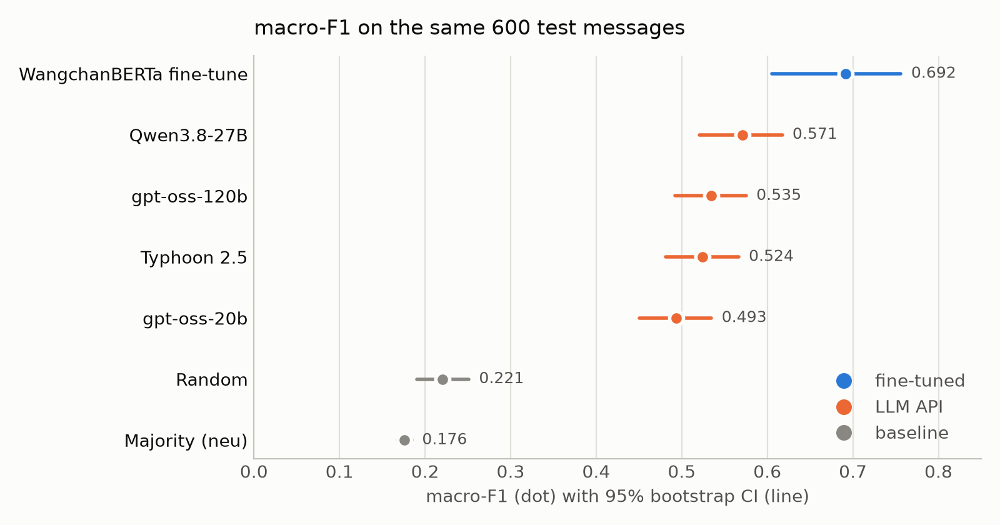
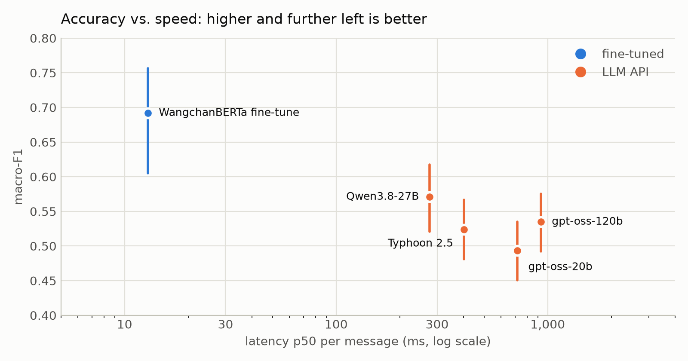

# Thai Text Classification: LLM APIs vs. Fine-tuning

Should a Thai company classify text with an LLM API or fine-tune a small model?
This project benchmarks both approaches on Thai social-media sentiment and reports
accuracy, latency, and cost, with confidence intervals for every number.

## TL;DR

- **A fine-tuned ~100M-parameter encoder beat every LLM API.** On the full test set,
  WangchanBERTa scored 0.668 macro-F1 vs. 0.555 for the best LLM (Qwen3.8-27B zero-shot),
  a difference of **+0.114 (95% CI +0.077 to +0.153)**, at **~21× lower latency**
  (13 ms on a T4 GPU vs. 276 ms via API).
- **Among LLMs, model choice mattered more than prompt engineering.** All LLMs landed within
  ~0.08 macro-F1 of each other. The reasoning model (gpt-oss) and the Thai-specialized model
  (Typhoon 2.5) did not beat Qwen, and few-shot examples gave no measurable gain.
- **The most accurate LLM was also the most expensive.** Qwen used only 2 output tokens per
  message, but its higher input price made it the costliest LLM per message.
- **The two approaches make opposite mistakes.** LLMs read sentiment and questions into
  messages annotators considered neutral; the fine-tuned model falls back to `neu` when unsure.
- **When an LLM still makes sense:** no labeled data, a prototype is needed in a day, or volume
  is low enough that latency and per-call cost do not matter.

## The question

LLM APIs need no labeled data and can be set up in an afternoon. Fine-tuned encoders need
thousands of labels and a GPU, but are small and fast. This project measures what you actually
gain or lose with each option on a real Thai dataset, instead of relying on intuition.

## Dataset

[Wisesight Sentiment](https://huggingface.co/datasets/pythainlp/wisesight_sentiment):
~26.7k Thai social-media messages (2016–2019), mostly about consumer products and services.

| Label | Meaning | Share of train |
|---|---|---|
| `pos` | positive | 17.9% |
| `neu` | neutral | 54.5% |
| `neg` | negative | 25.4% |
| `q` | question | 2.2% |

Three properties shaped the evaluation:

- **Heavy imbalance.** Predicting `neu` for everything gives 54% accuracy but only 0.176
  macro-F1, so accuracy alone is misleading.
- **Very few questions.** A 600-message test sample contains only ~13 `q` examples, which makes
  `q` F1 noisy. The final head-to-head therefore uses the full test set (57 `q`).
- **Annotation conventions are barely documented.** The guideline is a few sentences long,
  gives no rule for `q`, and reports no inter-annotator agreement. Error analysis showed that
  annotators label many questions and promotional posts as `neu`.

## Methods

**Baselines:** majority class (`neu`) and uniform random.

**LLMs (zero-shot, via API):**

| Model | Provider | Notes |
|---|---|---|
| gpt-oss-20b | Groq | reasoning model, `reasoning_effort=low` |
| gpt-oss-120b | Groq | same family, 6× larger |
| Qwen3.8-27B | Groq | dense; no hidden reasoning in its default setting (2 output tokens per message) |
| Typhoon 2.5 (30B-A3B) | Typhoon API | Thai-specialized, mixture-of-experts with ~3B active parameters |

All LLMs use `temperature=0` and the same prompt. The prompt uses a system role,
XML-delimited sections, label definitions with rules derived from error analysis, and escapes
`<` and `>` in user text to reduce prompt-injection risk.

**Fine-tuned encoder:**
[WangchanBERTa](https://huggingface.co/airesearch/wangchanberta-base-att-spm-uncased)
fine-tuned on the full train set (21,628 messages): 3 epochs, learning rate 3e-5, max length 256
(1.4% of messages truncated), best checkpoint selected by validation macro-F1. Text is lowercased
and spaces are replaced with `<_>` to match the model's pretraining format.

## Evaluation protocol

- **dev:** 300 messages, a stratified sample of the validation split, used for all prompt iteration.
- **test:** a 600-message stratified sample of the test split (all methods), plus the
  **full test split** (2,671) for the final head-to-head.
- The final configuration was **locked and committed before any test run**
  (see [`EXPERIMENTS.md`](EXPERIMENTS.md)).
- **Primary metric:** macro-F1 over 4 classes, with a 95% bootstrap CI (2,000 resamples).
- **Secondary:** macro-F1 over `pos/neu/neg`, per-class F1, accuracy, latency p50/p95,
  and cost per 1,000 messages.
- **Comparisons** use a paired bootstrap on the difference in macro-F1 over the same messages.
  A difference counts as real only if its CI excludes 0.

## Results

### All methods on the same 600 test messages

| Method | macro-F1 [95% CI] | macro-F1 (pos/neu/neg) | F1 `q` | Accuracy | Latency p50 / p95 (ms) | $ / 1k msgs |
|---|---|---|---|---|---|---|
| Majority (`neu`) | 0.176 [0.167, 0.185] | 0.235 | 0.000 | 54.3% | - | - |
| Random | 0.221 [0.190, 0.251] | 0.286 | 0.024 | 26.5% | - | - |
| **WangchanBERTa fine-tune** | **0.692** [0.605, 0.756] | **0.722** | **0.600** | **75.3%** | **13 / 32** | self-hosted |
| Qwen3.8-27B zero-shot | 0.571 [0.521, 0.617] | 0.623 | 0.413 | 63.8% | 277 / 843 | $0.270 |
| gpt-oss-120b zero-shot | 0.535 [0.492, 0.575] | 0.627 | 0.257 | 60.5% | 930 / 3222 | $0.111 |
| Typhoon 2.5 zero-shot | 0.524 [0.481, 0.566] | 0.607 | 0.274 | 58.2% | 402 / 574 | free API access* |
| gpt-oss-20b zero-shot | 0.493 [0.450, 0.535] | 0.573 | 0.255 | 55.2% | 720 / 2520 | $0.056 |

\* No public price was available at the time of the experiment.

<picture>
  <source media="(prefers-color-scheme: dark)" srcset="images/f1_dark.png">
  
</picture>

Paired comparisons between LLMs on these 600 messages:

| Comparison | macro-F1 difference | 95% CI |
|---|---|---|
| Qwen − gpt-oss-120b | +0.036 | +0.002 to +0.069 |
| gpt-oss-120b − Typhoon | +0.011 | −0.017 to +0.040 |
| Typhoon − gpt-oss-20b | +0.031 | +0.000 to +0.061 |

Two of these sit right at the edge, and several comparisons were run, so the safe reading is
**Qwen ≳ gpt-oss-120b ≈ Typhoon ≳ gpt-oss-20b**, with no large gaps between LLMs.
The per-model CIs in the first table should not be compared by checking for overlap; the paired
results are the correct comparison.


### Head-to-head on the full test set (2,671 messages)

| Method | macro-F1 [95% CI] | macro-F1 (pos/neu/neg) | F1 `q` | Accuracy | Latency p50 / p95 (ms) |
|---|---|---|---|---|---|
| **WangchanBERTa fine-tune** | **0.668** [0.634, 0.703] | **0.704** | **0.562** | **74.4%** | **13 / 31** |
| Qwen3.8-27B zero-shot | 0.555 [0.531, 0.579] | 0.608 | 0.394 | 62.4% | 276 / 826 |

**WangchanBERTa − Qwen: +0.114 (95% CI +0.077 to +0.153).**

<picture>
  <source media="(prefers-color-scheme: dark)" srcset="images/latency_dark.png">
  
</picture>

Dev scores were optimistic: Qwen dropped from 0.583 on dev to 0.555 on test, consistent with the
prompt having been tuned on dev errors. Reporting dev numbers would have overstated the LLM by ~0.03.

## Error analysis

Confusion matrices on the full test set (rows = true label, columns = predicted).

**Qwen3.8-27B zero-shot**

|  | pos | neu | neg | q |
|---|---|---|---|---|
| **pos** | 221 | 203 | 39 | 15 |
| **neu** | 238 | 877 | 208 | 130 |
| **neg** | 63 | 89 | 517 | 14 |
| **q** | 1 | 3 | 0 | 53 |

**WangchanBERTa fine-tune**

|  | pos | neu | neg | q |
|---|---|---|---|---|
| **pos** | 225 | 229 | 23 | 1 |
| **neu** | 138 | 1178 | 128 | 9 |
| **neg** | 19 | 104 | 558 | 2 |
| **q** | 0 | 28 | 2 | 27 |

- **The LLM over-reads neutral messages.** Only 60% of neutral messages were labeled `neu`;
  the rest went to `pos` (238), `neg` (208), and `q` (130). The LLM labels by what the words
  express, while annotators labeled by what the writer meant. The written rules in the prompt
  only partly closed that gap.
- **Questions: high recall vs. high precision.** Qwen predicted `q` 212 times and was right 53
  times (recall 0.93, precision 0.25): any interrogative sentence looks like a question to it.
  WangchanBERTa predicted `q` only 39 times and was right 27 times (recall 0.47, precision 0.69).
- **The fine-tuned model defaults to `neu`.** Its weakest class is `pos` (recall 0.47), with 229
  positive messages labeled neutral, the usual pull toward the majority class.
- **A warning about small samples.** On the 300-message dev set, WangchanBERTa found only 1 of 5
  questions (recall 0.20), which suggested `q` was its main weakness. On 57 test questions its
  recall was 0.47 and its `q` F1 beat the LLM's. Five examples were not enough to judge.

## How the LLM setup was chosen (dev set)

### Prompt iteration

| Prompt (gpt-oss-20b) | macro-F1 | Note |
|---|---|---|
| v1: plain label definitions | 0.449 | |
| v2: rules from error analysis | 0.490 | +0.041, ~50% more input tokens |

v1 sent many neutral messages to `pos` (50 of 161) and `q` (28). Reading those errors showed two
patterns: promotional or recommendation-style posts that annotators labeled `neu`, and casual or
sarcastic questions they did not treat as `q`. v2 turned these into explicit rules, such as
"judge the writer's own sentiment, not the sentiment words in the text."

### Few-shot did not help

Adding 8 hand-picked train examples (2 per class, including hard cases) moved Qwen from 0.583 to
0.594 on dev, but the paired CI was −0.020 to +0.044. It also doubled input tokens and reduced
throughput under per-minute token limits, so it was left out of the final configuration.

### Model screening (prompt v2)

| Model | dev macro-F1 | p50 latency | Output tokens / msg |
|---|---|---|---|
| gpt-oss-20b | 0.490 | 0.72 s | ~100 |
| Typhoon 2.5 30B-A3B | 0.484 | 0.34 s | 2 |
| gpt-oss-120b | 0.548 | 0.70 s | ~100 |
| Qwen3.8-27B | 0.583 | 0.25 s | 2 |

- **Qwen beat both gpt-oss models without hidden reasoning.** One hypothesis is that reasoning
  makes the model read sentiment into messages annotators considered neutral. This was not tested
  directly (for example, by varying `reasoning_effort`).
- **The Thai-specialized model did not win.** This compares a 3B-active MoE with a newer 27B dense
  model, using a prompt tuned on gpt-oss errors, so it says more about this setup than about Thai
  ability in general.

## Engineering notes

- **Latency was measured wrong at first.** The first timing wrapped the SDK's automatic retries,
  so time spent waiting on rate limits counted as model latency (p50 2.81 s instead of ~0.7 s).
  Retries are now handled manually, and only the successful call is timed.
- **Free-tier limits shaped the design.** gpt-oss-20b allows 200k tokens per day, about 250 dev
  messages. Every run writes one line per message and resumes where it stopped, so no API call is
  repeated.
- **Retryable vs. non-retryable errors.** 429, 5xx, and connection errors are retried with backoff,
  using the provider's `retry-after` hint when available. Other 4xx errors fail immediately.
- **"OpenAI-compatible" is not fully compatible.** Typhoon's `/models` endpoint returns a bare list,
  which breaks the OpenAI SDK, while chat completions work as expected. Both providers run through
  one OpenAI-SDK client with a different `base_url`.
- **Models disappear.** Models from the original plan were removed from Groq during the project,
  so model IDs are checked against each provider's `/models` list before use.

## Limitations

- One run per configuration at `temperature=0`. Uncertainty from test-set size is reported via
  bootstrap, but run-to-run API variance is not.
- Labels are noisy (no published agreement rate; some annotators saw images that are not in the
  dataset), so the achievable ceiling is unknown.
- The prompt was developed on gpt-oss errors and may favor some models over others.
- LLM latency includes the network round-trip and depends on provider load at the time of
  measurement (gpt-oss-120b's p50 rose from 0.70 s on dev to 0.93 s on test, on different days).
  WangchanBERTa latency is single-message inference on a Colab T4 GPU.
- Several pairwise comparisons were run; results with a CI bound near 0 are weak evidence.
- Prices are list prices at the time of the experiment. Typhoon had no public price.
- Qwen3.8-27B is a Preview model on Groq. Other models (Llama 4 Scout, Qwen3.6-27B) were removed
  from Groq during or shortly before this project, so exact reproduction may not be possible later.

## Reproduce

```bash
uv sync
cp .env.example .env            # add GROQ_API_KEY and TYPHOON_API_KEY
uv run make_splits.py           # creates data/dev.jsonl, test.jsonl, test_full.jsonl
uv run run_eval.py --model qwen/qwen3.8-27b --prompt zero_shot_v2 --split dev
uv run final_report.py          # tables in this README
uv run make_charts.py           # charts in images/
```

WangchanBERTa fine-tuning: [`notebooks/wangchanberta_finetune.ipynb`](notebooks/wangchanberta_finetune.ipynb)
(Google Colab, T4 GPU, ~20 minutes).

## Project structure

| File | Purpose |
|---|---|
| `make_splits.py` | stratified dev/test samples with a fixed seed |
| `prompts.py` | all prompt versions (earlier ones kept for reproducibility) |
| `llm.py` | one client for Groq and Typhoon, with retries and timing |
| `run_eval.py` | resumable evaluation runner |
| `metrics.py` | macro-F1, per-class report, confusion matrix |
| `compare.py` | paired comparison of two runs with bootstrap CI |
| `error_analysis.py` | samples misclassified messages by (true → predicted) |
| `final_report.py` | final tables for this README |
| `make_charts.py` | charts for this README (light and dark versions) |
| `EXPERIMENTS.md` | final configuration, locked before the test run |
| `notebooks/` | WangchanBERTa fine-tuning notebook |